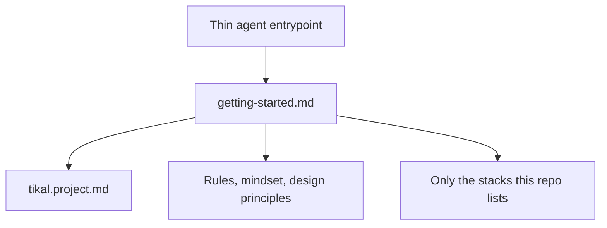

# Tikal

Tikal is a reusable instruction kit for AI coding agents. The problem it removes is a session full of instructions for some other project. An agent reads a thin entrypoint, then one router. The router opens this repository’s overview, the always-on rules, and only the stack this repository lists.

The kit is Markdown plus Python 3.11+ helper scripts. The scripts use the standard library. Tikal is not an application, a CLI product, or a language runtime.

The pages under `docs/` hold the usage and the graph for each feature. Agents do not load them.

- [Docs](docs/index.md)
- [Usage](docs/usage.md)
- [Context](docs/context.md)
- [Principles](docs/principles.md)
- [Commits](docs/commits.md)
- [Skills](docs/skills.md)

## License

Apache License 2.0. See [LICENSE](LICENSE).
