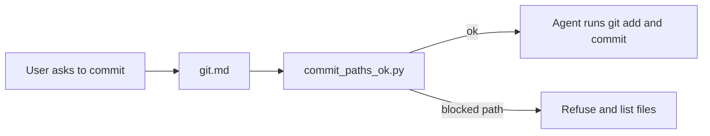
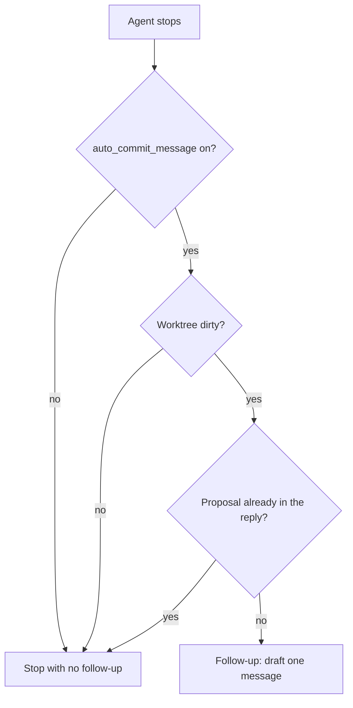

# Commits

An agent that commits on its own will record a change the person has not accepted. Tikal keeps that act with the person. `processes/git.md` is the judgment: what to include, what to leave out, and how to phrase the message. No script runs `git add` or `git commit`.

## When someone asks to commit

The agent opens `git.md`, chooses explicit paths, and runs the path guard. `commit_paths_ok.py` exits non-zero for a symlink toolkit, a secret, or another refused path. On success the agent stages those paths and commits. On failure it stops and lists the files.



The guard hides the denylist. Callers pass paths. They do not reimplement the checks. The workflow text stays in [git.md](../ai-coding-tools/processes/git.md).

```bash
python3 ai-coding-tools/scripts/commit_paths_ok.py --root . -- path1 path2
```

## A proposed message

`auto_commit_message: true` asks for a proposal after a turn that left the worktree dirty. The agent still does not stage or commit. Omitted or `false` means off. This repository leaves the flag off. `init_project.py` writes it as a comment. `resolve_stack.py` prints `auto_commit_message: true` only when the flag is on.

Reading the flag does not print a message. Two paths do.

1. At the end of a turn that changed files, the agent opens `ai-coding-tools/processes/git.md` and prints one copy-paste line under the heading `## Proposed commit message`: `git commit -m "why this change exists"`. That file lives on the `ai-coding-tools` link. A search that does not follow the link misses it, and the turn ends with no proposal.
2. A stop hook is the backup. If the reply has no `## Proposed commit message` and the worktree is still dirty, `propose_commit_message.py` sends one follow-up. The hook runs only after a host registers it. `init_project.py` does not add that registration. A new app has no `.cursor/hooks.json`, no Claude `Stop` entry, and no `.codex/hooks.json`. With the hook absent, a turn that skips the heading ends with no message.

The script decides whether to ask. It does not write the message, stage, or commit. It stays quiet when the flag is off, when the worktree is clean, or when the reply already has the heading. Installed while the flag is off, it prints `{}` and exits. A change that is already committed gets no proposal from a hook added afterward. The hook runs on the next turn that leaves the tree dirty.



Copilot and Windsurf have no stop hook here. They receive the message when the agent opens `git.md`.

Cursor, Claude Code, and Codex can register the same script. Each host continues once, then the hook stays quiet.

### Cursor

Add `.cursor/hooks.json` at the consuming repository root. Cursor runs that file from the repo root.

```json
{
  "version": 1,
  "hooks": {
    "stop": [
      {
        "command": "python3 ai-coding-tools/scripts/propose_commit_message.py",
        "loop_limit": 1
      }
    ]
  }
}
```

Cursor reads `followup_message` and submits it once.

### Claude Code

Add the command to `Stop` in `.claude/settings.json` at the repo root, or in `~/.claude/settings.json` for every repo. If `Stop` already lists other commands, add this one beside them. The session-summary command in [Usage](usage.md) can stay in the same list.

```json
{
  "hooks": {
    "Stop": [
      {
        "type": "command",
        "command": "python3 ai-coding-tools/scripts/propose_commit_message.py"
      }
    ]
  }
}
```

Claude Code reads `{"decision": "block", "reason": "..."}` and continues once.

### Codex

Hooks run unless `~/.codex/config.toml` sets `[features] hooks = false`. Add `.codex/hooks.json` at the repo root. Project hooks load only when that project is trusted. After you add the file, run `/hooks` and trust the new command. Codex skips it until that review is saved. A user-wide copy can live in `~/.codex/hooks.json`.

```json
{
  "hooks": {
    "Stop": [
      {
        "hooks": [
          {
            "type": "command",
            "command": "python3 \"$(git rev-parse --show-toplevel)/ai-coding-tools/scripts/propose_commit_message.py\"",
            "timeout": 30
          }
        ]
      }
    ]
  }
}
```

The `git rev-parse` form keeps the script path stable when Codex starts in a subdirectory. Codex uses the same `decision` / `reason` output as Claude Code.

The decision record for the proposal flag is [plans/auto-commit-message.md](../plans/auto-commit-message.md).
