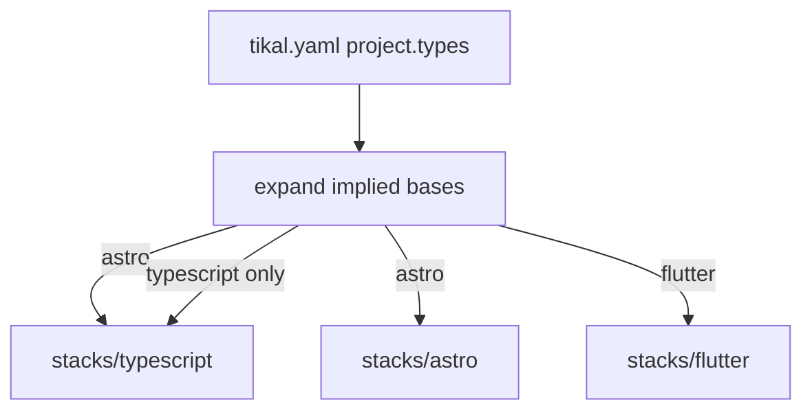

# Context

Every agent entrypoint used to open the same generic guide. A Flutter review rule would then land in every session, including repositories that do not contain Dart. Project-specific facts lived inside the toolkit, so editing them dirtied a submodule checkout.

The fix is an allow-list outside the toolkit and a router that honors it. `tikal.yaml` at the repository root names `project.types`. `processes/getting-started.md` loads `tikal.project.md`, the always-on process files, and `stacks/<type>/` for each type in the expanded list. Every other stack stays closed.

A type can imply a base. `astro` expands to `typescript`, then `astro`. `typescript` alone does not load Astro. `resolve_stack.py` is the source of that expansion. Hooks, init, and tests call it. Agents load the expanded list.



The diagram hides the file choice. A session does not decide which stack docs to open. The expanded type list is the whole decision. When the config is missing, marker detection fills it in; [Usage](usage.md) lists the markers.

The same boundary keeps the toolkit reusable:

```
consumer repo
├── tikal.yaml                 # allow-list: project.types
├── tikal.project.md           # this repo's overview
├── plans/                     # this repo's implementation plans
├── docs/                      # these pages; agents do not load them
├── CLAUDE.md / .cursor/rules  # thin: read tikal.yaml, then the router
└── ai-coding-tools/
    ├── processes/             # router and stack-agnostic workflows
    └── stacks/
        ├── flutter/           # loaded only if types includes flutter
        ├── typescript/        # listed, or implied by astro
        └── astro/             # implies typescript
```

What sits above `ai-coding-tools/` is the project. What sits inside it ships with the submodule or the symlink. Optional workflows — refactoring, benchmarking, git, and code review — open only when that work is happening. The always-on philosophy is in [Principles](principles.md).

Cursor cannot hide a rule file from a YAML file at session start. The portable mechanism, for Claude, Cursor, Copilot, and Windsurf, is the small router plus stack files opened on demand. Optional Cursor glob rules, such as `**/*.dart`, are templates copied into the consuming project so a Flutter review attaches when Dart files are in play.

This repository’s `tikal.yaml` has an empty `types` list. Agents working on Tikal do not load an application stack.

The decision record is [plans/stack-routed-context.md](../plans/stack-routed-context.md).
