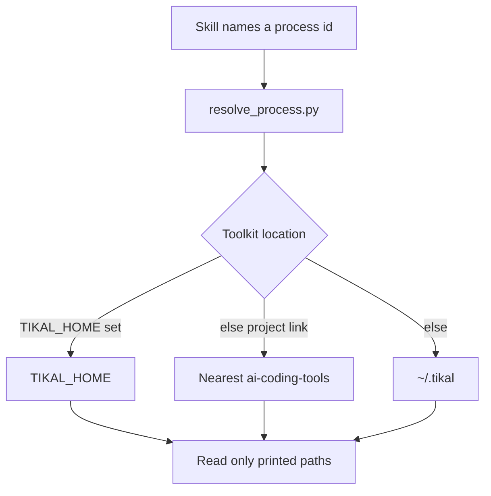

# Skills

A workflow copied into each skill becomes two documents the moment one of them changes. Tikal keeps a single copy. Process markdown is that copy. A skill names a process id. `resolve_process.py` prints the absolute files to read, and nothing else.



The diagram hides the search. `TIKAL_HOME` may be the clone root or the `ai-coding-tools` directory, and it wins when it is set. Otherwise the nearest ancestor that contains `ai-coding-tools/processes` wins, which pins a project to its submodule or symlink. Otherwise `~/.tikal`, a clone or a symlink to one, is the only home path. The script does not search other directories.

Calling a process does not replace the router. A project that already uses the router still loads the always-on files for ordinary work. A skill opens one process by id and reads only the paths the script prints.

```bash
python3 ai-coding-tools/scripts/resolve_process.py code-review
```

On-demand ids, also shipped as skills: `code-review`, `git`, `refactoring`, `benchmarking`.

Callable by id, and not installed as skills: `design-principles`, `rules-of-engagement`, `programmer-mindset`, `htdd-gate`. A project that uses the router already loads the first three.

`code-review` also prints `design-principles.md` and `stacks/<type>/review.md` for the project’s expanded types. `astro` includes TypeScript, then Astro. Types come from the project (`--root`, or the current directory). No config and no inferred types prints `stacks: none` and does not open every stack.

## Linking skills

Skill files live in `ai-coding-tools/skills/`. One `SKILL.md` serves Claude Code (`.claude/skills`, `~/.claude/skills`) and Cursor (`.cursor/skills`, `~/.cursor/skills`). `link_skills.py` symlinks them. It does not copy. `init_project.py` does not run it. A destination that already exists as something else is left alone.

```bash
python3 ai-coding-tools/scripts/link_skills.py --root .
python3 ai-coding-tools/scripts/link_skills.py --home
python3 ai-coding-tools/scripts/link_skills.py --home --skill tikal-code-review
```

`--skill` limits the set. The `tikal` index skill is included whenever a workflow skill is linked.

Home install:

```bash
git clone https://github.com/gerardoramirez/tikal.git ~/.tikal
# or: ln -s /path/to/cloned/tikal ~/.tikal
python3 ~/.tikal/ai-coding-tools/scripts/link_skills.py --home
```

Replace `/path/to/cloned/tikal` with the real checkout. The placeholder path creates a broken symlink.

Another skill calls a feature by naming the id and following the find steps in `ai-coding-tools/skills/tikal/SKILL.md`. It does not paste the process.
