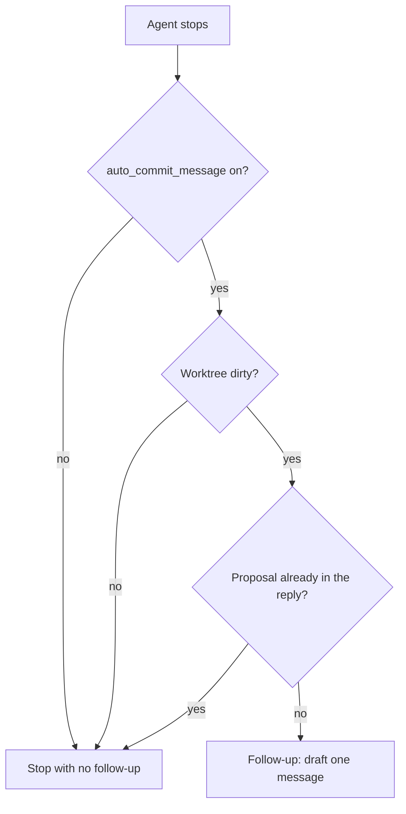

# Plan: Auto commit message

Agents keep the current rule: they commit only when you ask. What changes is an opt-in switch that, after a turn that left the worktree dirty, makes the agent propose one commit message in the chat.

`git.md` stays judgment, not a runner. No script runs `git add` or `git commit`.

## Current organization

```
tikal.yaml (types, code_reviews)
        │
        ▼
getting-started.md ── git.md only if you asked to commit
        │
        └── Claude Stop hook: save_session_summary.py (writes a summary, no git)
```

`processes/git.md` says not to commit unasked and not to add a script that stages or commits. `scripts/resolve_stack.py` already parses flat `project` keys such as `code_reviews`.

## Target organization

```
tikal.yaml
  auto_commit_message: true     # absent or false = off
        │
        ├── getting-started.md + git.md
        │     end of task: propose a message, do not commit
        │
        └── stop hook (Cursor and Claude), only if the flag is on
              dirty tree and no proposal yet
                    │
                    ▼
              one follow-up: read git.md, print the message, stop
```



## Flag

A boolean on `project`, same style as `code_reviews`:

```yaml
project:
  name: trail_app
  types:
    - astro
  auto_commit_message: true
```

- Omitted or `false` means off. This repo's `tikal.yaml` stays off.
- `init_project.py` writes it as a comment, like `code_reviews`.
- `resolve_stack.py` parses YAML and JSON and prints `auto_commit_message: true` only when on.

## What the agent does when the flag is on

- Load `git.md` at the end of a task that changed files, not only when you asked to commit.
- Run `git status`, `git diff`, and recent `git log`. Propose one message, why not a file list, in a HEREDOC, under the heading `## Proposed commit message`.
- Do not stage, commit, push, or amend.
- Commit cadence in `rules-of-engagement.md` stays the granularity guide when a commit is requested. The flag proposes a message. It does not authorize a commit.

Copilot and Windsurf only get this instruction path. They have no stop hook in this toolkit.

## Stop hook

`scripts/propose_commit_message.py` decides whether to ask. It does not write the message.

Fire only when all of these hold:

- Flag is on for the workspace root (`cwd` or Cursor `workspace_roots`).
- Status is a normal completion (`completed`, or Claude with no error/abort signal).
- This hook has not already continued the turn (`loop_count == 0`, and Claude `stop_hook_active` is false).
- `git status --porcelain` is non-empty.
- The last assistant text does not already contain `## Proposed commit message` (`last_assistant_message`, or the transcript when that field is absent).

Otherwise print `{}` and exit 0.

Output, chosen from stdin:

- Cursor (`cursor_version`, or `hook_event_name` when `stop_hook_active` is absent): `{"followup_message": "..."}`.
- Claude Code (`stop_hook_active` present, including beside `hook_event_name: "Stop"`): `{"decision": "block", "reason": "..."}`.

The follow-up text tells the agent to follow `git.md`, print one message under that heading, and not commit. If it did not change files this turn, it says so and stops. `loop_limit` is `1`.

A dirty tree that the agent did not touch can prompt once. The follow-up tells the agent to decline in that case. No session-start baseline.

The script is safe to install while the flag is off. Cursor consumers copy `.cursor/hooks.json` themselves. `init_project.py` does not merge an existing hooks file. Claude Code `Stop` uses the same command beside `save_session_summary.py`.

## Status

Implemented: `auto_commit_message` on `resolve_stack.py` and the init comment, process docs, `propose_commit_message.py`, unit tests, and the README / `tikal.project.md` wiring notes.
